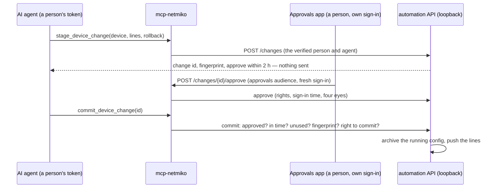

# Approve the device changes an AI asks for

With writes on (`make writes-on`), an AI platform can change device
configuration. In the default **`WRITE_MODE=approved`**, it never pushes on its
own: it **stages** a change, a **person** approves exactly that change, and only
then is it **committed** — once, within a short window. The stack enforces this
whatever the AI's settings or prompt say.



## Rights come from groups

Four rights, each a role in the person's token. Give them to **groups** in your
identity provider, never to named people:

| Right | Role (setting) | Allows |
|---|---|---|
| propose | `darqcube-propose` (`CHANGE_PROPOSE_ROLE`) | stage a change; withdraw it before approval |
| approve | `darqcube-approve` (`CHANGE_APPROVE_ROLE`) | approve or reject, through the approvals path only |
| commit | `darqcube-commit` (`CHANGE_COMMIT_ROLE`) | commit an approved change they asked for or approved |
| commit any | `darqcube-commit-any` (`CHANGE_COMMIT_ANY_ROLE`) | also commit a colleague's approved change (a shift handover) |

A typical split: engineers propose and commit; managers also approve; viewers
have none. Adding a person to a group gives them its rights from their next
token — nothing on the stack changes. The shared `MCP_AUTH_TOKEN` is a machine,
not a person: it cannot take part in a change.

## What it refuses

| Attempt | Result |
|---|---|
| Commit a change nobody approved | refused: not approved |
| An agent's token calls the approve route | refused: wrong audience (401) |
| An approvals token calls an MCP tool | refused: wrong audience (401) |
| Approve with a sign-in older than `CHANGE_FRESH_SIGNIN_SECONDS` | refused: needs a fresh sign-in |
| Approve without the approve right | refused |
| Approve your own change with `CHANGE_FOUR_EYES=true` | refused: four eyes |
| Commit after `CHANGE_COMMIT_WITHIN_MINUTES` | refused: expired |
| Commit the same change twice | refused: used |
| Lines changed after approval | refused: fingerprint differs |
| A colleague's change, with commit (own changes) | refused: not the asker or the approver |
| A protected line (`reload`, `write erase`, `no router bgp …`, users/AAA, a management interface) | refused at staging, naming the line |
| Two commands in one line (a newline inside it) | refused at staging |
| `POST /device/{d}/config` on the automation API | refused (403): direct pushes are off |

Every action, allowed or refused, is recorded with the person and the agent:
`make change-events`.

## Settings

Stack owner's policy — `site.yml` `changes:` (or `.env`):

| Setting | Default | |
|---|---|---|
| `WRITE_MODE` | `approved` | `direct`: the old one-step `push_device_config`, gated by `MCP_WRITE_ROLE` only. Unsafe for an AI |
| `CHANGE_APPROVE_WITHIN_MINUTES` | 120 | how long a change waits for a decision |
| `CHANGE_COMMIT_WITHIN_MINUTES` | 15 | how long an approval stays usable |
| `CHANGE_ROLLBACK_WITHIN_MINUTES` | 60 | how long after the push the declared rollback is allowed, once |
| `CHANGE_FRESH_SIGNIN_SECONDS` | 300 | how old an approver's sign-in (`auth_time`) may be |
| `CHANGE_FOUR_EYES` | false | the approver must not be the person who asked |
| `CHANGE_MANAGEMENT_INTERFACES` | — | interfaces a change may not shut or strip of their address |

Protected lines are data: [automation/changes/protected.yml](../../automation/changes/protected.yml).

The platform's identity facts — `site.yml` `ai_platform.auth:` (or `.env`): the
four role names, `CHANGE_APPROVALS_AUDIENCE` (default `darqcube-approvals`),
and `MCP_AGENT_CLAIM` (default `azp`, the claim naming the calling agent).
Callers need `MCP_AUTH_MODE=oidc` or `both`: approvals need a named person.

After a change: `docker compose up -d --force-recreate automation mcp-netmiko`.

## For an approvals app

The approvals path is plain HTTP on mcp-netmiko's port, for **people**. Each
call needs a token **for the approvals audience** — one your app obtains through
its own sign-in, which agents never receive. Ask the identity provider for a
fresh sign-in on every approval (OIDC `prompt=login` or `max_age=0`).

```
GET  /changes?state=waiting      every change (approvers) or your own (others); "can_approve"
GET  /changes/{id}
GET  /changes/events             the audit (approvers only)
POST /changes/{id}/approve       {"reason": "…"}   approve right, fresh sign-in
POST /changes/{id}/reject        {"reason": "…"}
POST /changes/{id}/withdraw                        the person who asked, before approval
```

A refusal is a 403 with `{"error": "<the rule, in words>"}`.

## For the AI agent

Five tools on mcp-netmiko (with writes on): `stage_device_change`,
`get_device_change`, `commit_device_change`, `rollback_device_change`,
`withdraw_device_change`. None can approve. A refusal comes back as the tool's
error, starting `refused:` with the reason, so the agent can say why.

## The automation API is loopback-only

The automation API has no authentication of its own and trusts the person
mcp-netmiko verified, so it is published on `127.0.0.1` by default
(`AUTOMATION_BIND_IP`). The MCP servers reach it over the Docker network; on the
host, `make state`, `make check` and the rest work as before. `make config-put`
works only with `WRITE_MODE=direct`.

## Check it

```bash
make mcp-check              # netmiko: 7 tools = changes on (approved); 2 = read only
make changes                # changes, newest first
make change-events          # every action, allowed or refused
```
